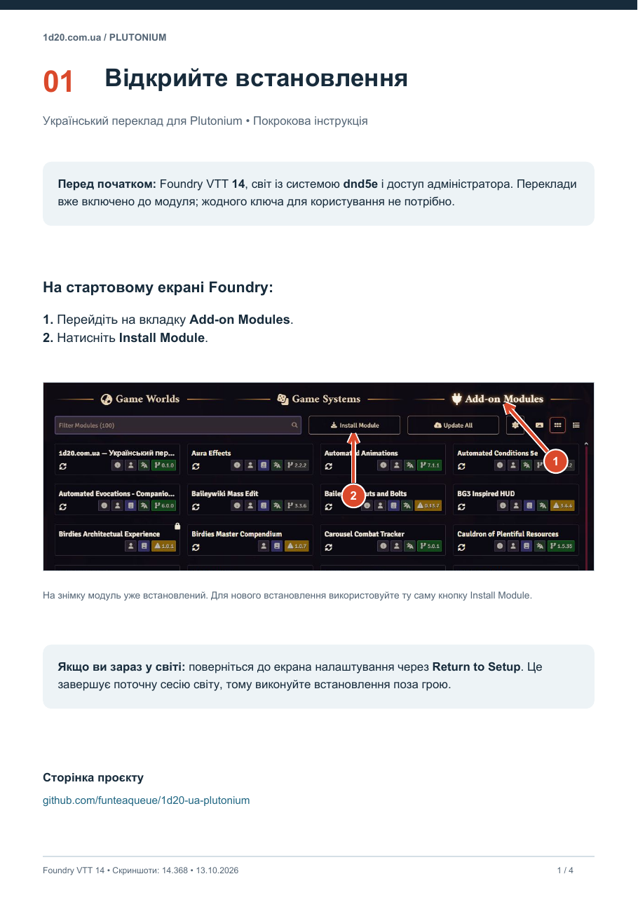
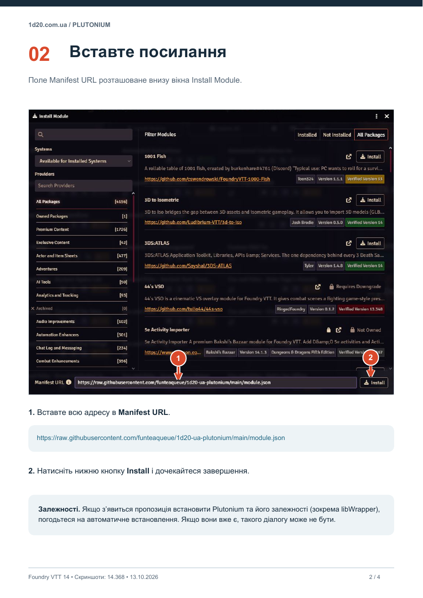
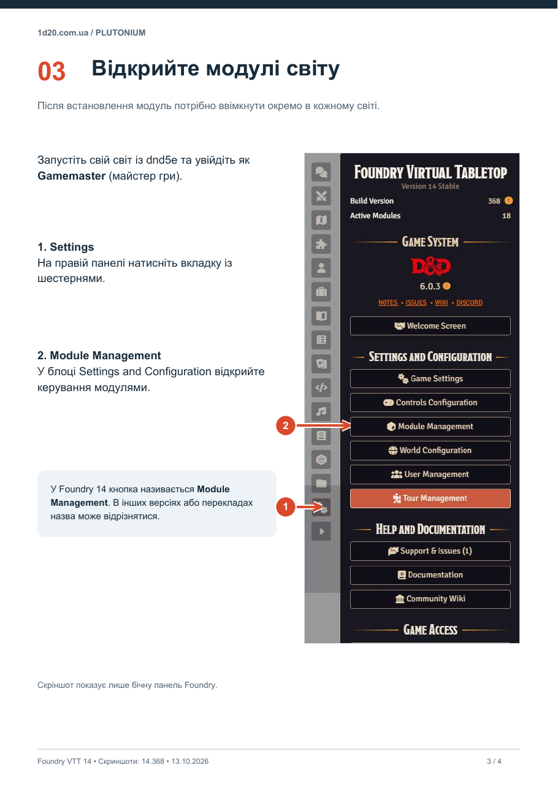
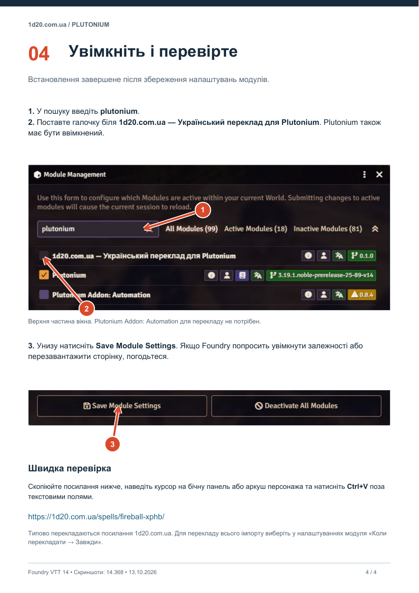

# Встановлення українського перекладу для Plutonium

Модуль **1d20.com.ua — Український переклад для Plutonium** додає українські назви й описи з 1d20.com.ua під час імпорту через Plutonium.

**[Завантажити PDF зі скріншотами та стрілками](../output/pdf/installation-uk.pdf)**

Скріншоти зроблено у Foundry VTT 14.368. Інтерфейс іншою мовою може мати інші назви кнопок.

## Перед початком

- Foundry VTT **14**, світ із системою **dnd5e** та доступ адміністратора до встановлення модулів.
- Якщо світ уже запущено, поверніться до екрана налаштування Foundry. Це завершує поточну сесію світу, тому робіть це поза грою.
- Переклади вже входять до модуля. Партнерський ключ або файл `.env` користувачам не потрібні.

## 1. Відкрийте встановлення модулів

На екрані налаштування відкрийте **Add-on Modules**, потім натисніть **Install Module**.



## 2. Вставте адресу маніфесту

У полі **Manifest URL** вставте всю адресу:

```text
https://raw.githubusercontent.com/funteaqueue/1d20-ua-plutonium/main/module.json
```

Натисніть **Install** і дочекайтеся завершення встановлення.



## 3. Установіть залежності

Якщо Foundry запропонує встановити відсутні залежності, погодьтеся на автоматичне встановлення **Plutonium** та його залежностей, зокрема **libWrapper**. Якщо вони вже встановлені, цей діалог може не з'явитися.

## 4. Увімкніть модуль у світі

Запустіть світ із dnd5e та увійдіть як майстер гри. Відкрийте **Settings → Module Management**.



У пошуку введіть `plutonium`. Позначте **1d20.com.ua — Український переклад для Plutonium** і переконайтеся, що **Plutonium** та **libWrapper** також увімкнені. Погодьтеся ввімкнути залежності, якщо Foundry запропонує це.

Натисніть **Save Module Settings** та підтвердьте перезавантаження сторінки, якщо з'явиться відповідний запит.



## 5. Перевірте переклад

Скопіюйте посилання на закляття:

```text
https://1d20.com.ua/spells/fireball-xphb/
```

Наведіть курсор на бічну панель Foundry або відкритий аркуш персонажа й натисніть **Ctrl+V**. Курсор не має бути в текстовому полі. Plutonium імпортує закляття, а модуль застосує переклад, якщо він є в пакеті даних.

За замовчуванням переклад вмикається для посилань **1d20.com.ua**. Посилання **5e.tools** імпортуються мовою оригіналу. Щоб перекладати також звичайний імпорт Plutonium, у налаштуваннях цього модуля виберіть **Коли перекладати → Завжди**.

## Якщо щось не працює

- Перевірте, що встановлено Foundry 14 і використовується сумісна версія dnd5e.
- Перевірте, що перекладач, Plutonium та його залежності ввімкнені саме в цьому світі.
- Після встановлення або оновлення перезавантажте сторінку Foundry.
- Якщо Ctrl+V не спрацьовує, вийдіть із текстового поля та перевірте налаштування **Вставляти посилання для імпорту**.
- Якщо імпортується англійський текст, використайте посилання з 1d20.com.ua або режим **Завжди**. Для записів без перекладу зберігається оригінал.

Український переклад: [1d20.com.ua](https://1d20.com.ua). Код модуля: [GitHub](https://github.com/funteaqueue/1d20-ua-plutonium).
